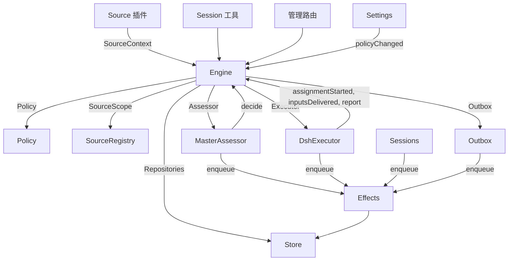

# 007 架构

本指南面向开发者，介绍系统的实现方式，并将[001 领域模型](001-domain.md)至[006 部署](006-deployment.md)中的概念映射到类、接口和文件。请先阅读 Runtime 和 Engine 的说明，再通过模块表和测试表查找代码。

## 核心类与粘合层

核心类通过精简接口承载领域概念，并封装外部边界。粘合层将工具参数、HTTP 请求、Source 载荷和 DeepSeek Harness 事件转换为对这些类的调用，再将结果转换为卡片、视图和消息。

`Runtime`（`src/app/runtime.ts`）负责构建应用、提供依赖并管理启动和关闭。`Engine` 构建自己的内部组件。Executor 和 Assessor 会回调 Engine，因此 Runtime 向它们提供 getter，避免构造顺序形成循环依赖。

### 运行时（Runtime）

`Runtime` 是组合根，不包含领域规则。它的构造函数会锁定状态目录、打开 Store 并构建各组件。如果构建失败，它会关闭 Store 并释放锁。

启动时会注册管理路由并运行 Setup。Setup 完成后，Runtime 会安装 Session 和 Executor hooks，确保主 Session 存在，启动 Policy 同步，恢复中断的 Assignment，并启动 pass 和 effect。`ready` 表示启动完成。

关闭时会取消当前轮次，等待 pass、effect 和 Agent 结束，恢复进程环境，关闭 Store 并释放锁。Source 插件通过精简的 `SourceHost` 接口将 Runtime 注入为 `orchestrator` 服务。

| 部分 | 模块 | 职责 |
| --- | --- | --- |
| Setup | `src/app/setup.ts` | 按照 Worker shell 的运行方式探测各 CLI，以解析仓库和账号；写入并应用 Worker 环境与命令 shim，并保存 Setup 问题。Settings 通过它检查更改后的账号；重启时也会再次运行 Setup。 |
| Passes | `src/app/passes.ts` | 同一时间只运行一个 pass，每两秒运行一次，也会在命令请求时运行：先处理到期的 effect，再调用 `Engine.evaluateDue`。Source 的 Trigger 也通过它到达 Engine。 |
| Outbox | `src/app/outbox.ts` | Engine 的 `Outbox` port，也是回执的唯一写入者：`send` 在一个事务中保存消息回执并排入 `reply` effect；effect handler 再通过 `SourceRegistry.send` 发送消息。Source 关闭时消息会等待；对话不存在或未监听时消息会被丢弃。 |
| Notices | `src/app/notices.ts` | 将领域事件和 Worker 活动转换为主 Session 消息。`eventNotice` 处理领域通知；`reportRelay` 立即转发问题，将普通进度保留在对应 Ticket 上，并转发其他报告；`followupRelay` 指明由哪些 Ticket 负责处理人的后续消息。某轮对话期间到达的 relay 会在下一步通过 DeepSeek Harness inbox 一并送达。 |

### 核心引擎（Engine）

`Engine`（`src/core/engine.ts`）是 Triggers、Threads、Decisions、Tickets 和 Assignments 的唯一写入者。它从 `src/core/ports.ts` 接收以下 port：`Repositories`、当前 Policy getter、`SourceScope`、`Assessor`、`Executor` 和 `Outbox`。可选依赖项包括 `prepareTicket`、`now` 和 `emit`。

Engine 的所有方法都是同步的。每条命令都在一个事务中修改其聚合。`evaluateDue` 会为每个被修改的 Eval 或 Ticket 单独使用一个事务。Ports 在事务中排入外部工作；适配器在提交后执行这些工作。无效请求会抛出 `UserError`。

Engine 对外提供一个入口，并将工作委托给五个内部组件。每条命令的事务由 Engine 管理。跨越多个组件的命令（例如 `attach`、`evaluateDue` 和 `policyChanged`）会按顺序调用这些组件。

每个组件都扩展 `EnginePart`（`src/core/part.ts`），由它提供配置和共享读取能力。组件之间的依赖沿单一方向流动：

| 组件 | 职责 | 依赖 |
| --- | --- | --- |
| `Intake` | 接收 Source 的 Trigger：连同 disposition 一起保存一次，记录到其 Threads 及关联中，分发给已订阅的 Ticket；除非消息来自已收到它的 Ticket 的用户，否则会在主 Thread 上排入 Eval。 | `Tickets` |
| `Evals` | 管理 Thread 的 Eval：批处理、gate 强度、actor，以及提供 Trigger 的依据（`primary`）；根据候选项送达时间计算截止时间并在暂停期间顺延；重新排入过期 Eval；处理候选项、回放和退回；在 Policy 更改时重新排入；并以 `accept`、`stop`、`ignore` 或 `unavailable` 结束每个 Eval。 | `Tickets` |
| `Tickets` | 管理 Ticket 生命周期：从 accept 创建 Ticket、Mandate、Subscription 和首个 Assignment；跟踪 Ticket 订阅的 Thread 及其关闭情况（`followsDone`）；处理附加 Thread 和仅用于上下文的 Thread；管理 Input 和备注；处理恢复及恢复时拒绝的消息、重试、重启、停止和结束；清理 Subscription；并通知受 Policy 变更影响的 Ticket。 | `Replies` |
| `Assignments` | 记录 Executor 及 Worker 报告的情况：Assignment 已启动、Input 已送达或送达失败、Assignment 因重启而中断，以及 Worker 附带给用户的问题报告。 | `Tickets`、`Replies` |
| `Replies` | 通过 `Outbox` 写入 Channel：根据允许规则发送确认、回答、结果和提醒消息。 | 无 |

命令使用祈使动词命名，例如 `stopTicket`；适配器报告的事实使用过去式命名，例如 `assignmentStarted`。查询 `candidate` 使用名词命名。

调用方只能获得符合其角色的 Engine `Pick` 类型：`EngineForSources`、`EngineForMainSession`、`EngineForPeople`、`EngineForSettings` 或 `EngineForExecutor`。

| 角色 | 方法 | 作用 |
| --- | --- | --- |
| Sources | `receive(trigger)` | 保存一次 Trigger；若没有 Source 接收它，则返回 `stored`、`duplicate` 或 `filtered`。Trigger 会分发给订阅其 Thread 的 Ticket；除非处理已暂停，否则用户消息会立即恢复已结束的 Ticket；Trigger 也会在其主 Thread 上排入 Eval，但已送达 Ticket 的用户消息仍归该 Ticket 处理。 |
| Sources | `bindThread(ticketId, thread, own)` | 让一个未结束的 Ticket 跟随 Source 的一个 Thread，例如拉取请求 Thread；当 Ticket 创建该 Thread 时，`own` 为真。再次绑定已关闭的 Thread 会重新打开它。Ticket 是否结束取决于 Thread 是否关闭，而不是 `ready` 报告。 |
| Sources | `threadClosed(thread, outcome, at)` | Thread 关闭时，每个跟随它的未结束 Ticket 都会记录这次关闭；当 Ticket 已处理完它跟随的 Thread（`followsDone`）时结束：如果 Ticket 创建过 Thread，则这些 Thread 必须都已关闭；如果没有创建 Thread，则它跟随的所有 Thread 都必须关闭。Ticket 按最近一次关闭的结果以 `merged` 或 `closed` 结束；但如果关闭后恢复的工作尚未报告 `ready`，或者 Executor 已确认或回答了其最新 Report（非 `progress`）之后收到并由它处理的用户后续消息，或尚未结束最后一轮工作，则暂不结束；此时 `dropped` 报告会让 Ticket 按 Thread 的关闭结果结束。 |
| Main Session | `candidate(triggerId)` | 返回持有该 Trigger 的 Eval，内容按 assessor 可见范围呈现。 |
| Main Session | `candidateDelivered(evalId)` | 标记 Eval 候选项已送达主 Session；截止时间从此刻开始计算。 |
| Main Session | `decide(triggerId, outcome)` | 记录 Eval Decision，或为显式请求直接记录 Decision。Accept 会原子地创建 Ticket、Mandate、Assignment、Subscription 并发送确认。若从卡片忽略推断候选项，会先记录 `ignoredFromCard`，再记录给定原因。只要 `followupOwners` 仍负责某条用户后续消息，就只允许执行 stop。 |
| Main Session | `attach(ticketId, triggerId, note?)` | 将 Trigger 路由到其指向的 Ticket，由该 Ticket 的 Executor 将它作为后续消息处理；同时结束持有该 Trigger 的 Eval，其中其他 Trigger 会等待新一轮 Eval。已结束的 Ticket 会在 Mandate 仍有效且处理未暂停时立即恢复。Executor 仍在处理的后续消息会被拒绝；路由回退回该消息的 Ticket 也会被拒绝。 |
| Main Session | `requestStatus(ticketId)` | 请求等待中的 Executor Session 报告状态，并返回是否已发出请求。 |
| Main Session | `note(ticketId, text)` | 以文本 Input 的形式向 Ticket 的 Executor 提供其他工作的事实；这不会授予任何权限。 |
| Main Session、Executor | `reply(request)` | 根据用途将消息排入对应 Channel：`acknowledgement`、`answer`、`result` 或 `attention`。 |
| People | `stopTicket(ticketId, reason?)` | 用户停止 Ticket，同时撤销 Mandate。 |
| People | `retryTicket(ticketId)` | 对等待用户处理的失败或阻塞 Report，或 Input 送达失败（`canRetry`）的 Ticket，结束停滞的 Assignment 并启动新 Assignment。 |
| People | `reevaluate(triggerId)` | 将已保存的 Trigger 重新排入 Eval。 |
| People | `unsubscribe(thread)` | 清除 Thread 上所有 Subscription，使跟随该 Thread 的 Ticket 不再跟随；每个 Ticket 仍会处理此前收到的后续消息。 |
| People | `dismiss(decisionId)` | 关闭 `unavailable` Decision 显示的问题，并由该 Decision 记录关闭状态。 |
| Executor | `assignmentStarted(ticketId, assignmentId)` | Assignment 开始运行，并发送等待中的 Input。 |
| Executor | `inputsDelivered(ticketId, assignmentId, inputIds)` | Input 已送达 Assignment 所属的 Executor Session，每条 Input 都会等待后续步骤读取。 |
| Executor | `inputsRead(ticketId, inputIds)` | Executor Session 已将这些 Input 对应的消息载入历史记录（即发生 `user/message` Session 事件），因此模型可以读取。若某步骤已认领这些消息，但在读取前被取消或失败，则不计为已读。后续发生 Report 或轮次结束后，这些消息才计为已读；重启后也一样，Ticket 结束也不会撤销已读状态。若 Input 送达时尚未记录读取，则在送达后发生 Report 或轮次结束时记为已读。 |
| Executor | `turnEnded(ticketId, assignmentId)` | Executor Session 的一轮已结束；在 Report 后，只有后台没有仍在运行的任务或已将工作交给用户时，才算结束。步骤此前取得的内容会被视为已读（`inputsRead`）。 |
| Executor | `deliveryFailed(ticketId, assignmentId, error)` | Input 送达失败；Ticket 会保留此状态，直到送达成功、启动新的 Assignment 或 Ticket 结束。 |
| Executor | `report(ticketId, report)` | 记录 Report 及其需要用户处理的问题；`dropped` 会结束 Ticket；如果 Ticket 没有跟随任何 Thread，`ready` 会完成该 Ticket；如果 Ticket 已处理完其跟随的 Thread，则会按 Thread 的关闭状态结束。 |
| Executor | `markUnrelated(ticketId, thread, reason)` | 只清除该 Ticket 对其认为无关的已附加 Thread 的 Subscription，并根据原因将该 Ticket 负责的该 Thread 后续消息退回。 |
| Executor | `followForContext(ticketId, thread)` | 让未结束的 Ticket 订阅相关 Thread 以获取上下文：Thread 消息会送达 Ticket，但不会增加后续消息处理权限，也不会恢复 Ticket。 |
| Executor | `handback(ticketId, triggerId, reason)` | 记录 Ticket 退回已送达的 Trigger，并附上候选项中的原因。如果该 Ticket 之前负责此消息，且没有其他 Ticket 处理它，就会将其重新排入 Eval；返回值说明是否已排入。每个 Ticket 对每个 Trigger 只退回一次，并保留原 Subscription。 |
| Executor | `assignmentInterrupted(ticketId, assignmentId)` | 宿主停止时，正在运行的 Assignment 可能在工作中被中断，也可能在最新 Report 后收到 Input；这两种情况都会像重试一样重新启动，并附带恢复说明及其 Executor Session 尚未读取的已送达 Input。若 Assignment 自最近一次中断后已有 Report，则保留原 Session。DshExecutor 会在启动时按 Ticket 从旧到新的顺序报告这些情况（`resume`），并重新排入等待中的 launch。 |
| Passes | `evaluateDue()` | 处理未暂停时：启动有排队 Trigger 的 Thread 的 Eval；每个 Thread 启动一个 Eval，并将期间排队的 Trigger 合并成一个批次。Eval 超过截止时间后会将 Trigger 重新排入两次，第三次记为 `unavailable`。若用户消息在暂停期间送达已结束 Ticket，且 Mandate 仍有效，则恢复该 Ticket。候选项尚未送达主 Session 的 Eval 不会过期。处理暂停期间不会有 Eval 过期；恢复后，每个截止时间都会按暂停时长顺延。 |
| Settings | `policyChanged(from, to, effects)` | 告知每个受变更影响的未结束 Ticket 变更原因（`src/policy.ts` 中的 `policyEffects`：原先接受该 Ticket 的规则发生变化或不再适用、请求者不再有权发起工作，或不再接受主动工作），并按新版本重新启动进行中的 Eval。 |

Engine 将批处理、授权、分发、恢复和提醒的生命周期规则封装在内部。以下共享谓词用于保证这些规则一致：

- `waitsForPerson`（`src/core/model.ts`）：最近一次 Assignment 报告了 `blocked` 或 `failed`，之后还没有收到用户消息。此条件成立时，自动 Input 和失败的 launch 都会保持等待。
- `followupOwners`：仍负责处理在自身 Thread 上收到的用户后续消息的 Ticket。Ticket 可以仍在运行，也可以已经结束但未被用户停止，并等待恢复。退回消息后，该 Ticket 不再拥有这条后续消息。
- `settled`：Decision 已处理请求；`stop`、`unavailable`、`routed` 和 `refused-stop` Decision 不算已处理。
- `ticketStage`（`src/core/stage.ts`）：实现[003 执行](003-execution.md)中的阶段表。

Ticket 结束时，未读的后续消息会重新进入 Eval，除非仍由其他 Ticket 负责，或已由其他 disposition 处理。已确认、已回答或已退回的消息不在此列。对于没有确认 disposition 的旧记录，会使用 Outbox 回执判断。最终 Report 也会涵盖 Assignment 启动时等待处理的消息，包括触发该 Assignment 恢复的消息。停止 Ticket 的消息不会自动重新评估。

变更完成后，Engine 会从 `src/core/ports.ts` 中定义的 `DomainEvents` 发出事件：

`trigger.received`, `eval.started`, `decision.recorded`, `ticket.created`, `ticket.resumed`, `ticket.ended`, `assignment.started`, `assignment.ended`, `thread.subscribed`, `thread.unsubscribed`, `trigger.requeued`, or `policy.changed`.

Runtime 会将 `ticket.ended`、`trigger.requeued` 和 `thread.unsubscribed` 转换为通知。送达 Ticket 的用户 `trigger.received` 事件会变成后续消息 relay。Ticket 以 merged 或 closed 状态结束时，`pullEndNotices` 会使用稳定 ID 发送一条聊天通知。其他事件目前没有消费者。

### 模型

`src/core/model.ts` 保存领域类型，`src/core/stage.ts` 定义 Ticket 阶段。Decision 使用 `reason` 记录原因，它是 `Reason`（`src/core/reasons.ts`）列表；每个 Reason 都包含 `code` 和 `values`，对于批次中的单个 Trigger，还包含其 `triggerId`。

核心错误代码（例如 `timeout`、`policyChanged`、`routed` 和 `startedTicket`）定义在 `REASONS` 中，Agent 通过 `reasonText` 读取其英文说明；gate 或 Source scope 也可以提供自己的代码，例如 `not_a_member`；`said` 则保存 assessor 或用户提供的文本。管理面板通过 `reason.<code>` 显示各代码对应的文案。Source 过滤 Trigger 时，也会用同样的方式记录 Source 提供的代码。

Ticket 对每项事实只保存一份。没有 `ended` 时 Ticket 处于打开状态；`ended` 会记录结束时间、执行者、原因和结果。Ticket 最近一次报告保存在 Assignment Report（`latestReport`）中；其 Executor Session ID 由 Ticket ID 派生（`src/executor/dsh.ts` 中的 `workerSessionId`）。

Ticket 字段均有明确类型：`origin` 保存使 Eval 批次获得相应强度的准入 Trigger 及整个批次（`triggerId`、`triggerIds`）；`execution` 保存 Executor 选择的内容（`name`、`directory` 和 `assignment`）；`delivery` 保存最近一次 Input 送达失败（`error`、`at`），直到送达成功、启动新 Assignment 或 Ticket 结束；`follows` 保存 Source 让 Ticket 跟随的 Thread，每项格式为 `{thread, own, closed?}`：若 Ticket 创建该 Thread，则 `own` 为真；Thread 关闭后，`closed` 会记录 `at` 和 `outcome`。只有 Ticket 可以写入 `follows`；GitHub Source 通过 `pullsOf` 和 `pullOf` 读取其拉取请求（`src/sources/github-pull.ts`）。

携带 Trigger 的 Input 会记录它是否由用户撰写，供 `waitsForPerson` 查询。Thread 还会在 `context` 中列出仅为获取上下文而跟随它的已订阅 Ticket，并在 `expired` 中记录其排队 Trigger 连续过期的 Eval 次数；Evaluation 会记录其 `primary` Trigger，以及候选项的 `delivered` 时间。

Trigger 的 disposition 会记录：通过分发或附加而收到它的 Ticket；用户是否将其重新排队；退回它的每个 Ticket 及原因；以及其 Executor 已确认或回答它的 Ticket。

Mandate 的 `basis`（`MandateBasis`）记录 gate 准入其 Trigger 的方式。重新验证时会读取接收方的 `source`、`scope` 和 `row`，列出的 `sender`、匹配的 `rules`，以及 `via`：

| `via` | 准入依据 |
| --- | --- |
| `addressed` | 已允许的发信人明确提及 Agent。 |
| `followup` | 消息到达一个已有 Ticket 的 Thread。 |
| `admission` | admission 表中的某个单元格；`observation` 表示这是推断候选项。 |
| `bot` | 已列出的机器人产生了推断候选项。 |

Trigger 和 Thread 的 `meta` 属于 Source，核心层不会解释这些内容。

### 策略（Policy）

`src/policy.ts` 定义设置 schema、授权和评估规则。每次调用 `settingsPolicy(settings, scope)` 都会返回一个新的无状态 `Policy`：

- `version`、`paused` 和 `evalTimeoutMs` 描述当前状态。
- `gate(trigger, thread, tickets)` 返回准入强度和依据。
- `revalidate(mandate)` 检查现有 Mandate 是否仍然有效。
- `admitsInferred(rules)` 只有在 auto 模式中且存在启用的匹配规则时，才允许主动接受请求。

`assessmentOutcome(assessment, settings, strength)` 将模型评估转换为 Engine outcome。它要求模型对每条启用规则都给出判断，明确处理方向，匹配一条规则，并提供意图证据。auto 模式之外，推断出的 accept 会记录为“would accept”。

`policyEffects(tickets, old, now, scope)` 会识别变更影响哪些打开的 Ticket，以及具体影响方式。`Engine.policyChanged` 只通知受影响的 Ticket。`policyVersion` 会对规则、accept 模式和各 Source 的 Policy 部分（包括机器人列表）计算哈希。

### 存储（Store）

`Store`（`src/app/store.ts`）独占一个 SQLite 数据库。Runtime 会先获取目录锁，再打开数据库，避免第二个进程迁移或写入同一份状态。

Store 的接口按用途分组：

- **领域 repository：**`atomic`，以及 `triggers`、`threads`、`tickets` 和 `decisions`；每个都提供 `get`、`save` 和列表查询。带索引的工作集包括 `threads.active()`、`tickets.open()`、`tickets.active()` 和 `read.subscribedThreads`。
- **读取查询：**`read` 通过 `threadTriggers`、`triggerStats`、`search` 和 `droppedReplies` 等方法为视图、工具和 Source 轮询提供数据。这些方法不会写入数据。
- **Source 元数据：**`threads.describe` 和 `threads.patchMeta` 更新由 Source 管理的 Thread 元数据。
- **设置：**`settings`、`saveSettings`、`blockRevision` 和 `settingsHistory`。Settings 和 Prompt 使用编号形式的 `Versions`（`src/app/versions.ts`）。
- **Outbox 回执：**`replyStatus` 和 `receipts`，且只由 Outbox 写入。回执操作包括 `get`、`waiting`、`behind`、`add`、`settle` 和 `withdraw`。`behind` 检查同一 Ticket 和对话中是否有更早的消息正在等待且失败次数少于三次。撤回的消息会以 `channelGone` 或 `channelIgnored` 状态结算。读取查询通过 `failingReplies`、`droppedReplies` 和 `droppedSince` 暴露失败和丢弃的回复。
- **有类型的键值记录：**使用 `KV` 中的条目，通过 `get`、`set`、`delete` 和 `keys` 操作。

`afterCommit` 只会在事务提交后执行操作，事务回滚后不会执行。Runtime 按记录的存储格式读取数据；schema 11 迁移会在启动时转换支持的旧格式记录。

### 副作用队列（Effects）

`Effects`（`src/app/effects.ts`）是持久化副作用队列。命令会在事务内调用 `enqueue(kind, key, payload)`；事务提交后才开始执行。

每个 kind/key 组合只有一行记录。将相同 key 再次排队时，会替换其 payload 并立即使其到期，但不会改变队列顺序。`handle(kind, run, options)` 为每个 kind 注册一个 handler。处理时会按记录从旧到新的顺序执行，且并发数不超过限制。

失败后会按指数退避策略重试。抛出 `Later` 会推迟工作但不计为失败，例如当前没有可用 Worker slot 时。`start` 会在 Setup 完成后开始处理；`drain` 会在关闭时停止处理并保留待处理记录；`pending`/`idle` 用于查询队列状态。

| 类型 | Handler | 职责 | 并发数 | 重试 |
| --- | --- | --- | --- | --- |
| `assessment` | MasterAssessor | 将 Eval 候选卡片引入主 Session 的轮次，然后通知 Engine 已送达，以此启动 Eval 截止时间。 | 4；暂停时不处理 | 从 2 秒开始，每次加倍，最长 60 秒。 |
| `launch` | DshExecutor | 启动待处理 Assignment：运行 prepare 命令、创建 Executor Session 并发送 Assignment 消息。 | 当前空闲的 Worker slot；暂停时不处理 | 模型提供方或网络偶发故障时，5 秒后重试，之后逐次加倍，最长 300 秒，最多三次；其他故障或 prepare 命令失败都会使 Ticket 失败。因暂停或 Worker slot 已满而等待的任务会在 5 秒后重试。 |
| `delivery` | DshExecutor | 按顺序将 Ticket 等待中的 Input 发送给正在运行的 Assignment。 | 4；暂停时不处理 | 从 2 秒开始，每次加倍，最长 60 秒；因等待 Worker slot 而暂缓的任务会在 2 秒后重试。 |
| `relay` | Sessions | 将 Worker 的报告或问题，或用户后续消息，引入主 Session 的轮次。 | 1，按队列顺序处理 | 从 2 秒开始，每次加倍，最长 60 秒。 |
| `notice` | Sessions | 在不唤醒主 Session 的情况下向其注入通知。 | 1，按队列顺序处理 | 从 2 秒开始，每次加倍，最长 60 秒。 |
| `reply` | Outbox | 通过 Source 为 Channel 发送消息；只有该 Ticket 发往此对话的更早消息未等待，或失败未达三次时才会发送。撤回消息会取消发送。 | 1；暂停时不处理 | 从 5 秒开始，每次加倍，最长 300 秒；若 Source 已关闭或有更早消息未完成，则 5 秒后重试。 |

每种类型都有一个同名的健康状态项。除 `delivery` 外，任一 effect 连续失败三次后都会报告错误；`delivery` 的失败会显示在对应 Ticket 上。Relay 和通知都保持队列顺序；某一条失败后，同类型的后续记录会等待它。

### 来源（Sources）

Source 通过 `src/sources/kind.ts` 中定义的 `SourceKind` 扩展宿主。kind 会声明自己的身份、标题、说明、配置 `schema` 和 `fields`、派生 `facts` 以及 `health` 项。可选行为包括 `scope`、`channel`（`allowed`、`send`、`link`）、`threadContext`、`find`、`policy`、`environment` 和 `refreshLabels`。

`SourceRegistry`（`registry.ts`）管理已注册的 kind 和已保存的实例，并实现 Engine 的 `SourceScope`。注册时会在 `HealthBoard` 上声明健康状态项；重复声明和保留的 `sync:` 名称会被拒绝。SourceContext 只能写入其注册时声明的状态项，因此注销后的报告不会产生效果。

Registry 配置方法包括 `kind`、`instances`、`instance`、`validate`、`validatePolicy`、`policyPart`、`channelAllowed`、`declarations`、`environments`、`find` 和 `scope`。`find` 会查询每个支持搜索的 kind。

通用代码通过 registry 访问 Source 行为。`send(message, commands)` 会调用对应 kind 的 Channel；kind 未安装时返回 `sent`、`gone` 或 `waiting`。`link` 会解析其 Channel 链接。`threadContext` 会将 kind 的读取器与其配置配对；若该 kind 没有读取器，则不返回内容。无效的已保存配置会禁用该实例。

插件会获得 `SourceHost`，其中包含 registry 和 `context(kind)`。kind 自身使用范围更窄的 `SourceContext`，由 `src/app/source-context.ts` 中的 `sourceContextOf` 构建。

该 context 提供 deployment 和 commands、Setup 就绪状态（`ready`、`configured`、`problem`）、配置、`receive`、`atomic` 和有类型的 `state`。它还提供 Thread 读取与元数据写入、Ticket 读取和绑定/关闭命令、Trigger 读取、通过 Outbox 发送的 `notify`，以及写入已声明健康状态项的 `report`。

### 执行器（DshExecutor）

`DshExecutor`（`src/executor/dsh.ts`）为每个 Ticket 提供一个 Session 和目录。`start` 和 `deliver` 会将 `launch` 和 `delivery` effect 排队。`stop` 通过 `Store.afterCommit` 取消当前轮次，因此事务回滚导致的结束不会停止 Worker。

`prepare(ticket, outcome)` 实现 Engine 的 `prepareTicket` hook，提供短名称、目录和 `ticketExecution` Assignment 文本。`workerSessionId(ticket.id)` 会派生 Session ID。

`WorkerSlots` 会在启动任务，或发送 Input 以唤醒空闲 Worker 前预留容量。用户消息可以额外使用一个超出 `maxWorkers` 的 slot，而且唤醒 Worker 的优先级高于启动新任务。`activeCount` 为管理面板提供当前负载。

Provider 和网络的暂时性故障会重试三次。Launch 使用 effect 退避策略；失败的轮次会分别在 15、30 和 60 秒后收到继续执行的消息。`inputMessage` 根据 Ticket 当前状态渲染每条 Input，`mandateInstructions` 则会为推断工作附加匹配规则的限制。

`install` 会订阅 Session 事件；`dispose` 会取消订阅。轮次通常以 waiting 状态结束；准备就绪或需要用户处理时除外。发生错误时则报告 failed。启动时，`resume` 会通过 `assignmentInterrupted` 报告中断的 Assignment，并按 Ticket 从旧到新的顺序重新排入不需要等待用户的 launch。

### 主评估器（MasterAssessor）

`MasterAssessor`（`src/app/assessment.ts`）让主 Session 评估主动候选项。`request` 会排入 assessment effect；Eval 结束时，`release` 会清除缓存状态。

其 `context`、`read` 和 `decide` 方法用于实现 `orchestrator_eval`、`orchestrator_eval_read` 和 `orchestrator_eval_decide`。这些方法通过 `SourceRegistry.threadContext` 提供范围受限的 Thread 上下文和仓库上下文，并提交 Decision。没有上下文读取器的 kind 只会提供 Trigger 和批次信息。

`assessmentOutcome` 会将模型回答转换为 `Engine.decide` 所需的结果。Evals 会根据当前 Policy 再次检查推断请求是否可以接受。

### 设置（Settings）

`Settings`（`src/app/settings.ts`）负责读写带 revision 的设置 block。`current` 和 `view` 用于读取；`save(block, value, revision, origin)` 会验证保存操作；`pause(paused, origin)` 会修改独立的 `paused` 设置。

每次保存都要声明来源：`panel`、`tool` 或 `sync`。只有 `panel` 可以更改执行环境或 `SETUP_FIELDS`（`src/deployment.ts`）中列出的字段。

Policy 版本变更时，会计算 `policyEffects`，记录已收到通知的 Ticket，并调用 `Engine.policyChanged`。`syncable` 和 `sync(id)` 用于刷新 Source 的 Policy 部分；`refreshLabels(id)` 用于刷新显示名称。

### Prompt 配置（Prompts）

`Prompts`（`src/app/prompts.ts`）以 `Versions` 形式保存配置。`current`、`version` 和 `history` 用于读取；`validate`、`preview` 和 `save(value, baseRevision, source)` 用于检查和保存；`compose` 和 `skills` 用于构建 Session 文本。

`builtInParts` 列出可覆盖的键、角色、默认文本和必需的模板占位符。每个 override 都保存团队 `text` 和 `base`，即原始默认值对应的 `builtInBase` 键。保存时会通过 `KV.prompts.builtIn` 保留该默认值。之后，`defaultChanged` 会报告发生变化的默认值（如有旧文本也会一并提供）以及已移除的部分。

验证时，如果 override 中省略了 base，会从已保存的 override 继承；如果已保存数据中包含被移除的部分，则会将其清理；空文本或其他未知键会被拒绝。这样，保存工具可以原样往返保存已读取的配置。`environmentSection` 和 `policySection` 只使用对象自身的键替换模板值，且只替换一次。没有 override 的配置使用默认值。

### Session 管理（Sessions）

`Sessions`（`src/app/sessions.ts`）管理两个角色使用的 DeepSeek Harness Session。`ensure` 会使用对应角色的模型创建 Session。`install` 会监听 Agent 事件，并为托管 Session 注册 Prompt、Skill 和工具。

`prompt` 会对每个 request ID 只发送一次。`relay` 和 `notify` 会将主 Session 消息排入队列，再由 `relay` 和 `notice` effect 处理。消息内容定义在 `src/app/notices.ts` 中；`delivery` 用于检查消息是否已送达。

每次模型请求都会将 Session 绑定到当前 Prompt revision。Session 用过的 revision 会持久保存：`promptVersion` 标识当前使用的版本，`mayRead` 限制 Worker 可以查看的版本。每个 Agent 的注册信息各自保存在独立 map 中。

`status` 和 `promptVersion` 为 Prompt 页面提供数据。保存操作通过 `Prompts.save` 执行，并通知主 Session。`modelRetry` 用于查询模型预算重试状态。

### 粘合层

| 粘合层 | 转换内容 |
| --- | --- |
| `src/app/runtime.ts` | 组合根：根据各组件所需接口构建组件，注册路由和 Source host，并启动或停止 dsh-superagent。 |
| `src/app/notices.ts` | 将领域事件和 Worker 报告转换为主 Session 的通知和 relay。 |
| `src/app/tools/main.ts`、`src/app/tools/executor.ts` | 将主 Session 和 Executor Session 的工具参数转换为对核心类的调用，再将结果转换为卡片。 |
| `src/app/http.ts`、`src/app/views/`、`src/app/api.ts` | 将 HTTP 请求转换为调用，并将 Store 读取的数据转换为管理面板视图；`api.ts` 为面板中的每个路由提供类型。 |
| `src/app/resources.ts`、`src/app/links.ts`、`src/app/cards.ts` | 将资源名称映射为读取操作，将 Source 消息转换为链接，并将记录转换为模型可用的精简卡片。 |
| `src/sources/github*.ts`、`src/sources/feishu*.ts`、`src/sources/poll.ts` | 将 GitHub 和 Feishu 载荷转换为 Trigger 和 Thread 事实，并将消息转换为 CLI 调用。 |
| `src/deployment.ts`、`src/setup.ts`、`src/infra/` | 处理 Setup 探测与问题、CLI 通信和 Agent 进程环境。 |

## 依赖规则

- **依赖明确且范围精简。** 每个类都通过接口声明所需依赖，接口大多是其他类的 `Pick` 类型：核心类使用 `ExecutorHost`、`AssessorHost`、`SessionsHost`、`SettingsHost`、`SetupHost`、`PassesHost` 和 `OutboxHost`；粘合层使用 `HttpHost`、`MainToolsHost`、`ExecutorToolsHost`、`ResourceHost`、`LinkHost` 和 `SourceContextDeps`，并按调用 Engine 的角色选择对应的 `Pick`。Runtime 只能通过这些接口传递自身。Source 插件注入的 `orchestrator` 服务类型为 `SourceHost`，其中包含 registry 和 `context(kind)`；Source kind 的代码只能看到 `SourceContext`。
- **模块导入边界。** 除 Node 的哈希功能外，`src/core` 不导入自身以外的模块，也不执行 I/O。`src/sources` 不从 `src/app` 导入内容。面板只导入宿主侧的类型，以及 `src/admission.ts`、`src/limits.ts`、`src/setup.ts`、`src/navigation.ts`、`src/sources/host.ts`、`src/core/errors.ts`、`src/core/reasons.ts` 中的普通值和 `src/app/api.ts` 中的筛选列表。
- **每种状态只有一个写入者。** 每种状态都由一个模块写入，其他模块只能读取或请求该写入者修改。

  | 状态 | 写入者 |
  | --- | --- |
  | Triggers、Threads、Decisions、Tickets、Assignments | Engine |
  | Source 的读取位置，以及它保存在 Thread 上的 `meta`（`label`、`url`、`facts` 和自有键） | 对应 Source 通过 `SourceContext` 写入 |
  | Settings 及其历史记录 | Settings |
  | Prompt 版本 | Prompts |
  | Effect 记录 | Effects |
  | Outbox 回执 | Outbox：Engine 消息和 Source 的 `notify` 都通过其 `send` 发送；`reply` effect 更新回执状态。 |
  | 健康状态项 | 在 `HealthBoard`（`src/infra/health.ts`）上声明它的组件；HealthBoard 会拒绝重复声明。`runtime` 由 Runtime 写入，Passes 通过 Runtime 上报；`evals` 由 Runtime 在每次 pass 后写入；`models` 由 Sessions 写入；各 effect 类型由 Effects 写入；`worker` 由 DshExecutor 写入；Source kind 的状态项由该 Source 对应的 SourceRegistry 写入；`sync:<id>` 由 Settings 写入。 |

  Source 只能通过会调用 Engine 的 `SourceContext.tickets.bindThread` 和 `threadClosed` 修改 Ticket。
- **请求与事实。** 表示请求的函数以祈使动词和对象命名，例如 `stopTicket` 或 `bindThread`，且可能被拒绝；记录适配器已执行操作的函数使用过去式命名，例如 `assignmentStarted` 或 `deliveryFailed`。每个 host 只会获得其角色需要的 Engine 类型。
- **类型化字段，Source 数据归 Source 所有。** 代码通过有类型的字段读取 Ticket 和 Mandate。Source 不会在 Ticket 上保存自己的数据：Ticket 跟随哪些 Thread 记录在 Ticket 的 `follows` 中；Source 关于 Trigger 或 Thread 的数据保存在对应的 `meta` 中。
- **固定拒绝。** 用户或 Agent 可能触发的拒绝，会通过 `src/core/errors.ts` 中 `USER_ERRORS` 定义的 `UserError(code, values)` 表示。管理 API 遇到 `missing` code 时返回 404，其他 code 返回 400；面板会用对应语言显示每个 code。Setup 问题由 `src/setup.ts` 中的 `SetupError` code 表示，固定健康状态文本由 `src/sources/host.ts` 中的 `HealthCode` 表示；这些提示也采用相同的文案处理方式。
### Source 专属依赖

部分通用模块仍然直接依赖 GitHub 或 Feishu：

- Outbox 会应用飞书聊天的字数限制。
- `src/app/links.ts` 会解析飞书消息链接和 `repliedTo`。它和 Runtime 通过 `feishuSettings` 读取设置。
- `src/app/resources.ts` 读取 `feishu/` 和 `github/` 原始记录；`src/app/cards.ts` 使用 `pullOf` 生成 Ticket 卡片。
- Ticket 以 merged 或 closed 状态结束时，Runtime 会发送 `pullEndNotices`。
- Executor 工具使用 Runtime 提供的 GitHub context，通过 `readPull` 和 `claimPull` 绑定已报告的拉取请求。
- MasterAssessor 通过 `readRepositoryPath` 读取仓库文件。
- Sessions 和 Prompts 只为 GitHub 和飞书注册内置 Skill。Migration 会转换 schema 10 中对应的记录。
- Setup 只探测 GitHub 和飞书账号字段（`SETUP_FIELDS`）。只有这些 Source 会通过 `SourceContext.problem` 接收账号 Setup 问题。

## 模块索引

| 路径 | 职责 |
| --- | --- |
| `src/project-source.ts` | 项目身份、规范化、来源绑定和精确项目选择 |
| `src/app/project-migration.ts` | 旧 GitHub 设置、历史策略与业务记录的事务迁移 |
| `src/infra/gitlab.ts` | 项目绑定的 glab Runner、分页、诊断、TLS 与 setup 探测 |
| `src/infra/ticket-shell.ts` | 在 Worker 和子代理每条 shell 命令内绑定工单环境 |
| `src/sources/project-context.ts` | Provider 局部身份与项目持久化命名空间之间的适配 |
| `src/sources/gitlab.ts` | GitLab Source 配置、策略、环境变量、轮询和插件入口 |
| `src/sources/gitlab-channel.ts` | 通过 glab 幂等发送 Issue、MR 和 Discussion 回复 |
| `src/sources/gitlab-trigger.ts` | Issue、MR、Note、审批与 Pipeline 的类型及 Trigger 规范化 |
| `src/sources/gitlab-read.ts` | GitLab 上下文、仓库文件、审批、Discussion 和 CI 读取 |
| `src/sources/gitlab-pull.ts` | MR 归属校验、关联、生命周期与终态通知 |
| `src/reporter/index.ts` | 本地 Reporter、脚本和可选模型协调器的公开入口 |
| `src/reporter/protocol.ts` | 严格场景与动作协议、隐藏 Oracle 和运行时快照类型 |
| `src/reporter/local-reporter.ts` | 输入日志、幂等恢复、本地输出、checkpoint、Oracle 和无模型回放 |
| `src/reporter/autonomous.ts` | 有界自主测试运行、模型预算、场景选择、证据和终态持久化 |
| `src/reporter/progress.ts` | Reporter 真实活动信号与只提醒、不终止运行的连续无进展监视器 |
| `src/reporter/browser.ts` | 受限的 loopback 管理页浏览器观察与语义动作 |
| `src/reporter/dsh-model.ts` | 复用 DSH 原生模型路由和每次调用的 `medium` 推理等级 |
| `src/client/reporter-status.tsx` | 只读展示自主 Reporter 进度、用量、实验和发现 |
| `src/reporter/script.ts` | 不调用模型的多角色场景脚本驱动器 |
| `src/reporter/coordinator.ts` | 注入模型的 User Simulator 与 Reviewer、安全投影、预算与中止控制 |
| `src/index.ts` | 主插件入口：读取机器设置、启动 Runtime，并为保存 Source 账号后触发 Runtime 重启提供回调。 |
| `src/deployment.ts` | 插件的 `Config` 和 `Machine`；`resolveDeployment` 和 `resolveFeishuBot` 从 Source 设置读取仓库及账号，Executor shell 运行时会调用相应 CLI；`SETUP_FIELDS` 列出 Setup 要读取的 Source 字段。代码中不写死任何人、账号或组织名称。 |
| `src/setup.ts` | Setup 问题：`SetupError` 包含 code 和处理位置，以及日志、主 Session 和管理面板共用的英文文本。 |
| `src/policy.ts` | Policy：各设置 block 的 schema、Policy 版本、gate 和 Mandate 重新验证。 |
| `src/admission.ts` | admission 表的值、每个单元格的选项和默认值，并与管理面板共享。 |
| `src/limits.ts` | 用户可设置值的范围；设置 schema 会进行校验，管理面板也会提供相应字段。 |
| `src/kv.ts` | `KV`：定义每类 `kv` 记录的键、值类型和所有者，以及 Store 和 `SourceContext.state` 使用的 `Key` 和 `Family` 类型。 |
| `src/navigation.ts` | 当宿主目录中列出某个 DeepSeek Harness Session 后，支持从管理面板打开该 Session。 |
| `src/core/model.ts` | 领域类型，包括有类型的 Ticket 和 `MandateBasis`，以及 `threadKey`、`ticketOutcome`、`reached`、`followupOwners`、`settled`、`waitsForPerson`、`liveTicket`、`runningAssignment`、`latestAssignment` 和 `latestReport`。 |
| `src/core/ports.ts` | 各 port：`Repositories`、`Policy`、`SourceScope`、`Assessor`、`Executor`、`Outbox` 和领域事件。 |
| `src/core/engine.ts` | Engine，即核心入口；以及角色接口 `EngineForSources`、`EngineForMainSession`、`EngineForPeople`、`EngineForSettings` 和 `EngineForExecutor`。 |
| `src/core/part.ts` | `EnginePart`（Engine 各组件的基类）和 `EngineOptions`。 |
| `src/core/intake.ts` | `Intake`：接收 Source 的 Trigger 并将其分发给 Ticket；除非用户消息已送达某个 Ticket，否则还会将它排入 Eval。 |
| `src/core/evals.ts` | `Evals`：管理 Thread 的 Eval 和对应 Decision。 |
| `src/core/tickets.ts` | `Tickets`：管理 Ticket 生命周期、Ticket 跟随的 Thread、Subscription 和 Input。 |
| `src/core/assignments.ts` | `Assignments`：记录 Executor 的事实及 Worker 报告。 |
| `src/core/replies.ts` | `Replies`：处理 Engine 发往 Channel 的消息。 |
| `src/core/stage.ts` | `ticketStage` 和 `canRetry`：定义[003 执行](003-execution.md)中的 Ticket 阶段。 |
| `src/core/errors.ts` | `UserError` 和 `USER_ERRORS`。 |
| `src/core/reasons.ts` | `Reason`、`REASONS` 和 `reasonText`：按 code 记录核心作出 Decision 或搁置 Trigger 的原因。 |
| `src/core/ids.ts` | `key`：根据输入派生 ID，相同输入会得到相同 ID。 |
| `src/core/memory.ts` | `MemoryRepositories`：供领域测试使用的内存 repository，行为与 Store 顺序一致，并支持嵌套回滚。 |
| `src/core/index.ts` | 核心层导出。 |
| `src/app/runtime.ts` | Runtime 组合根及其启动、停止逻辑。 |
| `src/app/setup.ts` | Setup，以及用于判断保存操作是否更改 Setup 所读字段的 `setupChanged`。 |
| `src/app/passes.ts` | Passes，即 pass 调度器。 |
| `src/app/outbox.ts` | Outbox：Engine 的 `Outbox` port、回执，以及用于发送回执的 `reply` effect。 |
| `src/app/notices.ts` | 主 Session 的通知与 relay：`eventNotice`、`reportRelay`、`resultRelay` 和 `followupRelay`。 |
| `src/app/store.ts` | Store 以及 Outbox 消息回执 `Receipt`。 |
| `src/app/store-read.ts` | `storeReads`：为视图、工具和 Source 轮询提供 Store 只读查询。 |
| `src/app/migration.ts` | schema 11 迁移：从 schema 10 进行一次升级，并按当前格式写入所有已保存记录。 |
| `src/app/effects.ts` | Effects 副作用队列。 |
| `src/app/versions.ts` | `Versions`：为设置和 Prompt 保存按编号排序的记录快照，并维护指向当前版本的指针。 |
| `src/app/cache.ts` | `TextCache`：将文本缓存在有容量上限的内存中，优先淘汰最近最少使用的内容。 |
| `src/app/settings.ts` | Settings。 |
| `src/app/settings-history.ts` | `policyHistory`：为每个已保存的设置 revision 记录相对前一版本的变更。 |
| `src/app/prompts.ts` | Prompts、`builtInParts`（团队可覆盖的内置部分）和 `promptParts`（角色 Prompt 各部分的顺序）。 |
| `src/app/context.ts` | 从 `prompts/` 读取的内置 Prompt 文本，以及 Session 读取的 transcript 条目。 |
| `src/app/skill-files.ts` | 打包文本：`promptFile` 会将文件中每行一句的内容合并为段落；此处还包含随包发布的 Skill。 |
| `src/app/sessions.ts` | Sessions。 |
| `src/app/delivery.ts` | `AgentDelivery`：确保每个 request ID 对 DeepSeek Harness Agent 只投递一次消息，即使 Session 已恢复也保持此规则。 |
| `src/app/retry-health.ts` | `RetryHealth`：追踪哪些 Session 正等待模型预算重试，为 `models` 健康状态项提供信息。 |
| `src/app/role-models.ts` | 解析 Eval 和 Executor 模型，并为新 Session 设置其角色对应的模型。 |
| `src/app/assessment.ts` | MasterAssessor、assessment schema 以及 `orchestrator_eval` 回答的窗口。 |
| `src/app/execution-environment.ts` | 执行环境：环境变量、Ticket 值、目录根路径以及 Prompt 部分的行；`src/app/prompts.ts` 会将这些内容填入模板。 |
| `src/app/source-context.ts` | `sourceContextOf`：为每种 Source kind 构建 `SourceContext`。 |
| `src/app/links.ts` | `sourceLink`、Trigger 消息页面以及 `candidateCard`。 |
| `src/app/cards.ts` | 面向模型的 Trigger、Ticket、Thread 和 Decision 精简卡片；Ticket 卡片状态的封闭集合 `TICKET_STATES`；以及 `textPage`。 |
| `src/app/resources.ts` | `RESOURCES` 和 `readResource`：定义各角色可通过 `orchestrator_read` 读取的内容。 |
| `src/app/tools/tool.ts` | `Tool` 类型、`readTool`、两个角色使用的 `orchestrator_read` 以及 `AcknowledgementSchema`。 |
| `src/app/tools/main.ts` | 主 Session 工具。 |
| `src/app/tools/executor.ts` | Executor Session 工具。 |
| `src/app/http.ts` | `/orchestrator/api` 路由：同源检查、请求限制，以及按失败类型返回对应状态码。 |
| `src/app/api.ts` | `Api`：定义每个路由的参数、query、body 和响应，以及列表筛选器。此文件只导入类型，因此可以打包到管理面板中。 |
| `src/app/views/text.ts` | 视图文本的两种形式：单行纯文本 `preview`，以及不含 HTML 的 `markdown`；还有 `plain` 和 `readable`。 |
| `src/app/views/records.ts` | 视图共用的数据行：Trigger、Ticket、Thread、Decision 和 Channel 链接；以及 `ownersOf`，用于按请求读取后续消息的归属方。 |
| `src/app/views/tickets.ts` | 按阶段分类的 Ticket 列表、单个 Ticket 页面、Mandate 依据事实和 Executor 负载。 |
| `src/app/views/threads.ts` | Thread 列表、单个 Thread 时间线、搜索和 Decision 列表。 |
| `src/app/views/sources.ts` | Source 状态：每个 Source 实例的状态、最近一天的计数，以及当天被过滤或丢弃的消息。 |
| `src/app/views/settings.ts` | 设置页面视图：各 block 的 revision、每个 Source 的设置及其 kind 表单，以及执行环境。 |
| `src/app/views/overview.ts` | 总览页面：需要用户处理的 Ticket、问题、最近一天的处理情况和 Executor 负载。 |
| `src/executor/dsh.ts` | DshExecutor、`WorkerSlots`、`ticketExecution`、`inputMessage` 和 `mandateInstructions`。 |
| `src/executor/background.ts` | DeepSeek Harness 中 Worker 的后台工作、Session 所拥有的 shell job（`ctx.jobs`）及子代理（`ctx.subagents`）；还包括 `runningJobs`、`untilQuiet`、`killJobs`、`collectJobs`、`stopSubagents`、`stopBackground`、`until` 和 `cancelled`，用于追踪因停止子代理而取消当前轮次的 Worker。 |
| `src/infra/commands.ts` | `Commands` CLI 通信层：`run`；限定到已配置仓库并经过校验的 `api` 和 `pages`；作为机器人的 `lark`；以及 `git`。`CliError` 保存命令输出中的错误代码（例如 GitHub HTTP 状态码）；命令没有输出时，错误只说明命令如何结束，不会泄露参数；`validItems` 会跳过并统计列表中的格式错误项。 |
| `src/infra/environment.ts` | Agent 进程环境：命令 shim、git 配置和凭据 helper、`runAsWorker`，以及执行环境和 Ticket 目录检查。 |
| `src/infra/paths.ts` | 包的根目录，即打包文件所在位置。 |
| `src/infra/text.ts` | 字数统计、聊天消息长度限制、`fill` 和 `sameName`。 |
| `src/infra/health.ts` | `HealthBoard`：管理各组件的健康状态项，每项都只能由一个写入者声明。 |
| `src/sources/kind.ts` | `SourceKind` 协议。 |
| `src/sources/registry.ts` | `SourceRegistry`。 |
| `src/sources/host.ts` | `SourceHost`、`SourceContext`、`Health`、`health` 和固定健康状态文本。 |
| `src/sources/poll.ts` | GitHub 和 Feishu 轮询共用的逻辑：`POLL_HORIZON_MS`、`polled`、`cursorAt` 和 `pollThreads`；轮询失败会以 `pollError` 记录在对应 Thread 上。 |
| `src/sources/github.ts` | GitHub kind 和插件入口，导出为 `./github-watch`：每轮轮询通知、打开 Ticket 的拉取请求及其 CI，以及已订阅的 Thread。 |
| `src/sources/github-trigger.ts` | 将 GitHub 评论、Review、Issue 正文和 CI 变更转换为 Trigger，并处理 GitHub 地址。 |
| `src/sources/github-pull.ts` | 拉取请求规则：Ticket 跟随哪些拉取请求（`claimPull`、`observePull`）、向 Engine 报告关闭的逻辑，以及 Ticket 以 merged 或 closed 状态结束时发送聊天通知的 `pullEndNotices`。 |
| `src/sources/github-channel.ts` | GitHub Channel：处理评论和 Review 线程回复，返回 `sent` 或 `gone`。 |
| `src/sources/github-read.ts` | CI 快照、仓库读取、`github/` 资源，以及按页读取 Issue 或拉取请求对话的 `githubThreadContext`。 |
| `src/sources/feishu.ts` | Feishu kind 和插件入口，导出为 `./feishu-watch`。 |
| `src/sources/feishu-trigger.ts` | 根据统一规则将实时事件、历史页和话题页中的飞书消息转换为 Trigger。 |
| `src/sources/feishu-loops.ts` | 飞书轮询循环：事件消费者、历史恢复、聊天名称和已订阅话题轮询。 |
| `src/sources/feishu-channel.ts` | 飞书 Channel：处理话题回复，返回 `sent` 或 `gone`。 |
| `src/sources/feishu-read.ts` | 从 `feishu/` 读取 Trigger 消息及其根消息、父消息和话题；`feishuThreadContext` 会将这些内容及图片提供给评估流程。 |
| `src/sources/admission-context.ts` | 评估使用的受限上下文窗口：通过对应 kind 读取 Trigger 所属 Thread 的前几页，以及 Trigger 附近的消息。 |
| `src/sources/feishu-image.ts` | 读取飞书消息中的图片，并作为附件提供给评估 Session。 |
| `src/client/index.tsx` | 客户端插件入口：注册侧边栏入口、主面板和 DeepSeek Harness Plugin Manager 页面。 |
| `src/client/app.tsx` | 管理面板：页头、搜索、术语表、标签页和当前路由对应的页面。 |
| `src/client/provider.tsx` | 各页面从宿主获取的内容：文案、调用、导航、通知、状态轮询，以及 `restart`；重启期间 dsh-superagent 会快速读取状态。 |
| `src/client/api.ts` | 调用和轮询管理 API（类型定义来自 `src/app/api.ts`），并提供 Eval 状态的 Decision 筛选器。 |
| `src/client/route.ts` | 标签页、设置分组、`parseRoute` 解析的有类型路由，以及记录上次打开设置分组的路由状态。 |
| `src/client/overview.tsx` | 总览页面。 |
| `src/client/source.tsx`、`trigger.tsx`、`eval.tsx`、`execution.tsx` | 每个阶段对应一个文件：展示该阶段状态及其设置（如有）。 |
| `src/client/thread.tsx`、`ticket.tsx` | 记录详情页：Thread 页面展示时间线，Ticket 页面展示授权、Input 和 Assignment。 |
| `src/client/settings.tsx` | Settings 标签页：设置分组导航和当前显示的分组。 |
| `src/client/settings-kit.tsx` | 设置 block 的构建组件：各阶段分组共用的设置、`useBlockDraft`、字段（包括 Source kind 的字段）和保存历史。 |
| `src/client/prompts.tsx` | Prompt 设置：页面持有读取的视图，编辑器持有草稿；Edit、Full prompt 和 History 标签页根据这些状态渲染。内置部分的编辑器会显示已变更的默认值，并可保留或移除 override。 |
| `src/client/prompt-config.ts` | 以纯函数形式处理 Prompt 配置：按区段划分的团队配置、Skill 名称、内置部分（`part/<key>`，含 `withOverride`）、Prompt 视图显示的部分标题，以及完整 Prompt 的逐行差异。 |
| `src/client/deployment.tsx` | Deployment 设置，也会显示在 DeepSeek Harness Plugin Manager 中。 |
| `src/client/draft.tsx` | 设置草稿：`draftReducer`、草稿状态、与较新保存 revision 的合并逻辑、`saveBarText`（保存栏文案）和保存栏。 |
| `src/client/controls.tsx` | DeepSeek Harness 控件的本地实现。由于 bundle 不导入 `@deepseek-ai/dsh-client-ui-primitives`，这些控件会遵循宿主的标记结构、键盘行为和设计 token；它们不读取 context。 |
| `src/client/widgets.tsx` | 页面共用的小型组件，这些组件会读取面板 context：区块、页面标题、加载状态、时间、链接、需确认的操作、Setup 检查和 Markdown。 |
| `src/client/rows.tsx` | 页面共用的数据行：Ticket、Thread 和 Decision 行、Thread 标签，以及自动消息序列的折叠显示。 |
| `src/client/markdown.ts` | 将报告和问题中的 Markdown 子集及消息中的裸地址解析为区块和行内部分。 |
| `src/client/text.ts` | 按键获取文案，并生成领域值、原因、发送者和时间的显示文本。 |
| `src/client/marks.ts` | 为视图分类的状态生成标记：Ticket 或 Thread 阶段、Source 状态和 Decision 结果；每个标记包含圆点、图标、色调和标签。 |
| `src/client/locales.ts` | 两种语言的全部文案，以及[001 领域模型](001-domain.md)中的术语表。 |
| `src/client/client.css`、`css.d.ts` | 管理面板样式表，并以文本方式加载。 |

GitHub、GitLab 与 Feishu Source 分别从 `./github-watch`、`./gitlab-watch` 和 `./feishu-watch` 导出，由 `tsdown.config.ts` 构建。`./reporter` 导出供本地协调器使用的脚本与可选模型接口；普通 Runtime 不会自动调用模型。bundle 通过 `cordis.patch.yml` 注册 Source 插件，具体默认开关见该文件。

## 测试

| 测试 | 覆盖范围 |
| --- | --- |
| `tests/projects.spec.ts` | 多项目身份、配置、执行环境、并发与跨项目领域授权 |
| `tests/project-context.spec.ts` | 旧身份、新项目与 Reporter Trigger 的上下文隔离和路由 |
| `tests/project-migration.spec.ts` | 停机迁移、回滚、历史策略版本、活动授权和 Eval 恢复 |
| `tests/reporter.spec.ts` | 本地 Reporter 协议、持久化、隐藏 Oracle、脚本与回放 |
| `tests/reporter-coordinator.spec.ts` | 假模型驱动的多轮行为、隐藏 Oracle、严格输出、预算、取消与成本未知处理 |
| `tests/reporter-progress.spec.ts` | 无进展提醒只更新状态、不取消运行，并在真实进展后重新计时 |
| `tests/reporter-runtime.spec.ts` | 真实 Runtime/Engine 的本地闭环、GitHub/GitLab 同号项目和 MR 报告路由 |
| `tests/reporter-autonomous.spec.ts` | 自主选择、多轮目标反馈、证据、预算、幂等与运行恢复 |
| `tests/reporter-browser.spec.ts` | loopback 浏览器登录、同源限制、语义动作和凭据隔离 |
| `tests/reporter-dsh-model.spec.ts` | 原生 DSH 模型调用的 medium 配置、用量映射和失败分类 |
| `tests/panel-overview.spec.tsx` | 概览与自主 Reporter 状态、证据、用量及发现展示 |
| `tests/gitlab-vpn-e2e.spec.ts` | 显式门控的真实 glab 认证、Issue/MR 幂等评论、MR 生命周期与资源清理；默认跳过 |
| `tests/gitlab.spec.ts` | Fake glab 的参数、分页、认证、TLS、项目隔离、讨论交付、临时故障和 CI 证据 |
| `tests/ticket-shell.spec.ts` | 真实子进程中的并发环境绑定、转义、权限与宿主环境保持 |
| `tests/core-engine.spec.ts` | 基于内存 repository 验证领域规则：接收、Eval、分发、恢复和停止；中断的 Assignment；暂停；Policy 变更；报告和结果；附加；回复；送达失败；关闭问题。 |
| `tests/stage.spec.ts` | 逐项验证 Ticket 阶段。 |
| `tests/policy.spec.ts` | Source scope、gate、admission 表、Mandate 重新验证、Policy 版本、设置迁移和评估结果。 |
| `tests/registry.spec.ts` | `SourceRegistry`：实例、校验、Policy 部分、Channel 和 Thread 上下文。 |
| `tests/sources.spec.ts` | Feishu 和 GitHub Source 使用 `SourceContext` 时的行为：转换、轮询和读取位置、拉取请求规则及健康状态。 |
| `tests/commands.spec.ts` | 使用部署账号调用 CLI、Channel 返回结果，以及限定到指定仓库的 GitHub 调用。 |
| `tests/feishu-read.spec.ts`、`tests/github-read.spec.ts` | 飞书和 GitHub 数据读取。 |
| `tests/admission-context.spec.ts`、`tests/feishu-image.spec.ts` | 评估使用的 Thread 窗口，以及飞书图片读取。 |
| `tests/assessment.spec.ts` | MasterAssessor 为每个 Eval 保存的内容及其释放时机。 |
| `tests/background.spec.ts` | 等待 Worker 的 shell job 和子代理：唤醒 Worker 的结束事件，以及停止任务的宿主。 |
| `tests/bundle-patch.spec.ts` | 按 DeepSeek Harness 的读取方式验证 bundle patch，以及 patch 为 Executor Session 定义的 Agent preset。 |
| `tests/effects.spec.ts` | Effect 队列：合并、限制、退避重试、健康状态和关闭。 |
| `tests/passes.spec.ts` | Pass：同一时间只运行一个；pass 运行期间收到的请求会在之后合并运行；失败 pass 报告 Runtime 健康问题。 |
| `tests/outbox.spec.ts` | Runtime 运行时的 Outbox：处理暂停或 Source 未安装时，消息会等待。 |
| `tests/cache.spec.ts` | `TextCache` |
| `tests/queue.spec.ts` | Runtime 通过 effect 队列处理工作，以及旧版本保存的数据。 |
| `tests/followups.spec.ts` | 用户在 Ticket Thread 上发送后续消息：发送给主 Session 的通知、处理该消息的工具、突发消息的处理成本；Worker 的退回和上下文跟随，以及主 Session 的备注。 |
| `tests/health.spec.ts` | 每个组件都有独立健康状态项，并由该组件下一次成功操作清除。 |
| `tests/delivery.spec.ts` | `AgentDelivery` |
| `tests/retry-health.spec.ts`、`tests/role-models.spec.ts` | 模型预算重试，以及两个角色使用的模型。 |
| `tests/runtime.spec.ts` | 在模拟 DeepSeek Harness 宿主上，通过工具和 HTTP 验证整个应用。 |
| `tests/tools.spec.ts` | Session 工具：各角色通过 `orchestrator_read` 读取的内容，以及其他主 Session 工具的格式与校验。 |
| `tests/runtime-concurrency.spec.ts` | 并发工作：pass 运行期间收到 Trigger，以及 delivery 和 launch 期间发生变化的 Ticket。 |
| `tests/http.spec.ts` | 同源和 loopback 检查、各类失败的状态码、请求正文大小限制、路径参数和查询参数。 |
| `tests/settings.spec.ts` | 与模型或账号检查并发的设置保存、被保存操作抢先完成的 Policy 同步，以及暂停、同步和 block 操作的拒绝情况。 |
| `tests/views.spec.ts` | 管理视图从 Store 派生的数据，例如被丢弃消息所属的 Thread。 |
| `tests/timeline.spec.ts` | Thread 分页和 Trigger 邻近消息按时间及 ID 排序的行为，确保所有已收到 Trigger 的时间格式一致。 |
| `tests/migration.spec.ts` | schema 11 迁移：所有记录均转换为当前格式，并拒绝更旧的 schema。 |
| `tests/store.spec.ts` | SQLite 和内存中的 repository 及其工作集、kv 区域、仅在 `src/kv.ts` 和迁移中声明的所有 `KV` 键、设置历史和查询。 |
| `tests/prompts.spec.ts` | Prompt 校验、组装和版本。 |
| `tests/cards.spec.ts` | 逐文件检查内置文本必须说明的规则。 |
| `tests/model-surface.spec.ts` | 检查模型可读取的所有内容：工具、Prompt、Skill 和 Input；并对照工具 schema、执行环境、术语表及各角色的大小限制进行验证。 |
| `tests/deployment.spec.ts`、`tests/environment.spec.ts`、`tests/index.spec.ts` | 插件配置和 Setup、Agent 进程环境及插件入口。 |
| `tests/service-script.spec.ts` | 使用伪造的 `ps`、`tmux` 和 `dsh` 测试 `scripts/dsh-superagent`。 |
| `tests/client.spec.tsx`、`tests/navigation.spec.ts`、`tests/controls.spec.tsx` | 客户端插件的注册与轮询、Session 导航和路由状态、本地控件，以及管理面板的无循环导入结构。 |
| `tests/panel-overview.spec.tsx`、`panel-source.spec.tsx`、`panel-trigger.spec.tsx`、`panel-eval.spec.tsx`、`panel-execution.spec.tsx` | 使用按路由响应的伪造管理 API 测试管理面板各页面。 |
| `tests/panel-settings.spec.tsx`、`panel-prompts.spec.tsx`、`panel-deployment.spec.tsx`、`panel-panel.spec.tsx` | 设置分组、草稿和历史、Prompt、Deployment 页面，以及管理面板搜索、术语表和路由状态。 |
| `tests/draft.spec.ts`、`tests/prompt-config.spec.ts`、`tests/markdown.spec.ts`、`tests/marks.spec.ts` | 草稿状态、合并和保存栏文案；分区 Prompt 配置及逐行差异；Markdown 子集及其链接；视图分类的所有状态标记。 |
| `tests/locales.spec.ts`、`tests/styles.spec.ts` | 两种语言的文案和样式表。 |
| `tests/class-docs.spec.ts` | 确保 `src` 中的每个 class 之前都存在 JSDoc 块。 |
| `tests/docs.spec.ts` | 编号文档只能链接到更早的文档；所有本地链接都有效；文档中没有合并冲突标记；本文档中的表格列出了所有模块和测试。 |

`tests/fixtures/` 保存多个测试共用的内容：`host.ts` 是模拟的 DeepSeek Harness 宿主；`panel-server.ts` 和 `panel.tsx` 分别是伪造的管理 API 及其页面外壳；`deployment.ts` 是已解析的 deployment；`git.ts` 为测试启动的所有 git 命令提供一个不绑定任何仓库的环境；`async.ts` 提供异步测试工具。

## Docker 部署文件

容器入口创建隔离的 DSH Web profile、链接本地产品 bundle，并把管理界面绑定到 loopback。部署配置不包含 GitHub/GitLab 或模型凭据。

| 文件 | 职责 |
| --- | --- |
| Dockerfile | 多阶段构建，安装 DSH、gh、glab 与 Worker 命令依赖，并以 UID 1000 运行 |
| .dockerignore | 从构建上下文排除持久化目录、凭据、开发缓存和运行日志 |
| compose.yaml | host 网络、持久化 bind 目录和 Runtime 健康检查 |
| docker/entrypoint.sh | 初始化缺失的 profile、验证 CLI/profile，并提供启动、状态与健康命令 |
| docker/profile.patch.yml | 将 Web 与 Reporter 绑定 127.0.0.1，并选择持久化 stateDir |
| docs/011-docker-bootstrap.md | 911pro 部署、fork 自举、模型配置、Reporter 与运维流程 |

## 持久化

所有数据保存在一个 SQLite 文件 `<stateDir>/orchestrator.sqlite` 中，且只有 Store 会打开该文件。

| 表 | 内容 | 写入者 |
| --- | --- | --- |
| `trigger` | 每个 Trigger 及其时间 `at`。时间使用统一的 `Date#toISOString` 格式，在 Engine 接收 Trigger 时设置，以便按文本比较时间。 | Engine |
| `disposition` | 每个 Trigger 的处理去向：若被过滤则保存 Source 原因 code；还保存其 Eval 和 Decision、通过分发或附加而收到它的 Ticket、是否重新排队、退回它的 Ticket 及原因，以及已确认或回答它的 Ticket。 | Engine |
| `trigger_thread` | 记录每个 Trigger 所属的 Thread、时间和是否由用户撰写。这样无需扫描所有 Trigger 即可读取 Thread 上的 Trigger，并按时间和 ID 排序；Thread 时间线后续页面使用 `<at>|<id>` 游标，且时间相同的 Trigger 不会被跳过。 | Store 在保存每个 Trigger 时写入。 |
| `thread` | Thread 的 Subscription、仅为上下文而跟随它的 Ticket、已排队 Trigger、进行中的 Eval、连续过期次数和 `meta`；派生列 `active` 在存在排队 Trigger 或正在运行 Eval 时置位，`subscribed` 则记录当前订阅它的 Source。 | Engine；`meta` 由 Source 写入。 |
| `ticket` | Ticket 的 Mandate、来源、执行信息、Assignment、Channel、Input 及其跟随的 Thread；派生列 `open` 在 Ticket 尚未结束时置位，`active` 在 Input 尚未送达或最近一次 Assignment 正在等待或运行时置位。 | Engine |
| `decision` | 按 Thread 保存的 Decision。 | Engine |
| `effect` | Effect 队列：按 kind 和 key 保存 payload、顺序、包含最近一次错误的失败尝试记录，以及下次到期时间。schema 11 迁移会重新排入旧版本为主 Session 保存的工作。 | Effects；schema 11 迁移会重新排入旧版主 Session 工作。 |
| `outbox` | 每条发往 Channel 的消息回执，按 ID 保存目标 Ticket 和 `status`（`pending`、`sent` 或 `dropped`），避免重复排队；丢弃消息还会将时间及原因 code 保存在派生列 `dropped` 中。等待发送的消息会关联 `reply` effect，由它保存尝试次数。 | Outbox |
| `kv` | 其他所有按键保存的记录。 | 定义该记录的组件。 |

派生列根据所在行的 JSON 计算；若记录不属于该列对应的集合，则值为空。每个派生列的非空数据都有索引，因此 pass 只需读取活跃工作。Store 打开较旧数据库时会补齐新增的列。

`KV`（`src/kv.ts`）定义每种键值记录的所有者、键和值类型。所有读写方都使用这些条目；只有迁移代码会直接引用旧键。

| 记录 | 键或内容 |
| --- | --- |
| Schema | 当前 schema 版本。 |
| 设置版本 | `settings-revision`、`settings-version:<n>`、`settings-block-revision:<block>`；快照还包含来源、Policy 版本和受影响的 Ticket。 |
| Prompt 版本 | `prompt-revision`、`prompt-version:<n>`。 |
| 主 Session | `master-id`。 |
| Session Prompt 历史 | `session-prompts:<session id>`。 |
| Source 状态 | 读取位置（例如 `github-cursor:<number>`）、PR CI 指纹和已读取的 Feishu 话题消息；键名以 kind 或 `thread-` 加 Thread key 开头。 |
| 显示名称 | `source-labels:<source id>`。 |

关闭状态保存在对应 Decision 上。Input 文本在读取时根据 Ticket 渲染，因此两者都不需要单独的键值记录。

读取缓存使用有容量限制的内存 `TextCache` 实例，重启后会丢失。Session 分页读取 Source 原始记录或 Prompt 预览时，重启后必须从 offset 0 重新读取。接收消息后解析的飞书链接也按同样方式缓存；只有本次进程运行期间读取过该链接后，才能通过链接搜索到它。

目前还不会删除旧记录，因此以下数据会持续增长：`trigger`、`disposition` 和 `decision` 行；已结束的 Ticket 及其 Thread；Outbox 回执；以及 `kv` 中保存的每个设置 revision 和 Prompt 版本、各 Session 使用过的 Prompt revision，以及 Source 按 Thread、Issue 或拉取请求保存的记录。

`SCHEMA_VERSION` 只会递增。新版本数据库会拒绝由旧代码启动；`src/app/migration.ts` 会在启动时将预发布 schema 10 数据库升级一次，并拒绝更旧的版本。

## 面向模型的接口

### 主 Session 工具

主 Session 有 14 个应用工具：

| 用途 | 工具 |
| --- | --- |
| 读取和路由 | `orchestrator_read`、`orchestrator_route` |
| 管理 Ticket | `orchestrator_ticket_retry`、`orchestrator_ticket_request_status`、`orchestrator_ticket_note` |
| 重新评估 | `orchestrator_trigger_requeue` |
| 评估主动工作 | `orchestrator_eval`、`orchestrator_eval_read`、`orchestrator_eval_decide` |
| 沟通和取消订阅 | `orchestrator_reply`、`orchestrator_thread_unsubscribe` |
| 配置 | `orchestrator_settings_save`、`orchestrator_policy_sync`、`orchestrator_prompts_save` |

`orchestrator_route` 按顺序接收 1–20 个 Decision。每个 accept、attach、stop 或 ignore 都会作为独立的 Engine 命令执行。它也允许直接从卡片中忽略推断候选项。`orchestrator_ticket_note` 会将事实作为上下文发送，不会授予权限。

设置保存可以选择 `policy`、`eval`、`executor`、`pause` 或 `source`；选择 `source` 时还要提供 Source ID。Prompt 保存请求设置 `preview: true` 时，只会组装文本而不会保存。

主 Session 还可以使用 DeepSeek Harness 提供的 `skill`、`bash`、`read`、`read_image`、`job_output`、`job_list` 和 `job_kill`。避免读取代码是 Prompt 规则，而不是工具权限限制。

### 预设与等待限制

新建的主 Session 使用 `dsh-superagent-router`（`ROUTER_PRESET`）。Shell 命令和 job 等待会在 5 秒后返回。如果 Web UI 在第一轮开始前选择了其他 preset，`Sessions` 会恢复为该 preset；Worker 则恢复为 `WORKER_PRESET`。

`src/app/sessions.ts` 中的 `noWait` guard 会拒绝主 Session 执行在命令位置调用 `sleep` 的 shell 命令、`timeoutMs` 超过 30 秒的 shell 命令，以及等待超过 5 秒的 `job_output`。Report 和 job 结果会自动送达，因此等待只会延迟候选项到达。

仍在使用 `standard` 的既有主 Session，也需要为前台命令和 job 等待显式设置超时；否则该 preset 默认分别会等待 60 秒和 30 秒。宿主通过 `presetForSession` 判断当前 preset，如果无法读取，则回退到 Session projection 或 header；若这些信息也不可用，则假设使用 `standard`。

### Executor 工具

每个 Executor 有六个应用工具：

| 工具 | 用途 |
| --- | --- |
| `orchestrator_read` | 读取当前 Ticket 可访问的资源。 |
| `orchestrator_ack` | 确认请求。 |
| `orchestrator_report` | 报告进度或结果，并根据拉取请求规则绑定拉取请求。 |
| `orchestrator_thread_unrelated` | 取消对无关的已附加 Thread 的订阅，退回由其负责的后续消息，并向主 Session 说明原因。 |
| `orchestrator_thread_follow` | 订阅相关 Thread 以获取上下文，并通知主 Session。 |
| `orchestrator_trigger_handback` | 根据候选项中的原因退回一条消息，且每条消息只退回一次。 |

如果消息仍由其他 Ticket 负责，或当前 Ticket 从未负责过该消息，退回操作会返回 `queued: false`。例如，机器人消息可能已经独立进入 Eval。

Worker preset 定义在 `cordis.patch.yml` 中，并通过 `WORKER_PRESET` 选择。`src/app/sessions.ts` 中的 `WORK_TOOLS` 保留可用的文件、搜索、shell、job、web、skill、todo 和 subagent 工具。Worker 不会获得向用户提问或展示内容、修改 profile、在 Worker slot 之外安排工作、启动或向其他 Session 发消息、编辑外部文档的工具。Ticket 结束后，工具调用会被拒绝。

### 结果格式与评估上下文

路由结果格式为 `{decision?, reason, ticket?}`。`orchestrator_route` 返回 `{results}`，保留条目顺序，并为每项添加 `trigger_id` 和 `kind`。无效或被拒绝的条目会返回 `refused` 和原因，但不会中止整个批次。

设置和 Prompt 保存操作会返回已保存的配置。Policy 同步会返回 Source、允许列表大小，以及 `added` 和 `removed` 名称。

`orchestrator_eval` 返回上下文，而不是指令。评估指令位于 `runtime/admission`（`prompts/admission.md`），规则位于 `runtime/policy`。它的上下文包括：

- Trigger 文本，最多 4,000 个字符，并包含图片 ID 和批次中的其他 Trigger。
- 最多八个 `related_tickets`，打开的 Ticket 优先排列；以及 `tickets_total`。
- Eval 的 `policy_version`。
- Thread 消息窗口：前五条消息，以及 Trigger 前后各五条消息。消息格式为 `{id, from, at, text}`，通常最多 400 个字符；Trigger 前后各两条消息最多 1,200 个字符。被截断的消息会包含 `chars`；图片引用使用 `images`。
- 其他已加载消息以 `{id, from, preview}` 格式提供，每条预览最多 50 个字符。`orchestrator_eval_read` 可按 ID 展开这些消息。

Ticket 卡片使用 `src/app/cards.ts` 中封闭的 `TICKET_STATES` 集合：状态可以是打开阶段（例如 `person/review` 或 `working/queued`），也可以是已结束结果。无论通过 accept、assessment 还是 `orchestrator_ack` 提交，确认消息都不能超过 100 个单词。

### 读取资源

`src/app/resources.ts` 中的 `RESOURCES` 定义所有资源，并生成工具的 `resource` 描述。

| 资源 | 内容 |
| --- | --- |
| `tickets`、`triggers`、`threads`、`decisions` | 分页列表，格式为 `{items, next_offset}`；活动列表按时间从新到旧排列。 |
| `decision/<id>` | 单个 Decision。 |
| `thread/<key>` | 标签、Ticket、最近的 Decision，以及一页 Trigger。 |
| `trigger/<id>` | 消息文本、回复所针对的 Trigger 及邻近消息，不包括 CI 运行记录。 |
| `ticket/<id>` | 关联 ID、Source 批次中的 Trigger、Thread，以及 Assignment 和 Input 的第一页。 |
| Ticket 子资源 | `/assignments`、`/inputs`、`/assignment`、`/result`、`/report/<assignment id>`、`/transcript`、`/message/<n>`、`/input/<id>`。 |
| `settings`、`settings/<block>` | Revision 和摘要，或可直接保存的完整 block。 |
| `prompts`、`prompts/<revision>`、`prompts/current`、`prompts/defaults`、`prompt-preview/<id>` | Prompt 配置和组装后的文本。 |
| `models`、`models/<provider>` | 可用模型。 |
| `feishu/<trigger id>/…`、`github/…` | Source 原始记录，具体说明见 Source Skill。 |

仅用于上下文跟随的 Ticket Thread 会标记为 `context`，由 Source 绑定的 Thread 标记为 `bound`。Assignment 页面按时间从新到旧排列，并包含 Report 预览。使用 `next_offset` 继续读取列表。`/input/<id>` 接受 Input 名称或 ID。`settings` 会完整返回较小的 block，并概述 Policy 和 Source block。

Source 资源包括消息邻近内容、`github/pulls/<n>/thread/<comment id>` 和 `github/commits/<sha>/checks`。

原始消息会统一读取为精简格式 `{id, from, at, text, reply_to?, path?, line?, url?}`，而不是保留 GitHub 或 Feishu 的原始记录格式。

Executor Session 只能读取自己的 Ticket、对应 Thread、送达自己的 Trigger 或由其请求持有的 Trigger、工作期间使用的 Prompt 版本以及原始消息。页面不会暴露它无权读取的对象 ID、Decision 或其他 Ticket。

页面显示的每个 ID 都可以用于继续读取对应对象，因此 Session 可以从一个对象跳转到下一个对象。没有读取接口的哈希值（例如 Eval ID 或 Policy 版本）不会显示在页面中。

文本页默认上限为 4,000 个 UTF-16 code unit，最多 8,000 个；列表默认每页 20 项，最多 50 项。

早期版本使用的 `event/`、`task/` 和 `observation/` 名称仍然可以解析。

### 送达 Session 的消息

以下消息会被引入主 Session 的轮次：

| 消息 | 内容 |
| --- | --- |
| Candidate | 批次 Trigger 卡片、Thread、`related_tickets`、`tickets_total`、`delivered_to`、Issue/PR 链接引用的 Ticket、`handed_back` 原因和下一步操作。 |
| `follow_up` | Executor 所见的一条消息、`replies_to`、接收该消息的 Ticket，以及“由 Executor 决定如何处理，主 Session 只能停止工作”的提示。 |
| `worker_report` | Ticket 卡片、来源 Trigger、状态和最多 600 个字符的摘要；截断时提供 `chars` 和读取指针。 |
| `worker_attention` | 携带问题的 Ticket 卡片。 |

其他通知会在不唤醒主 Session 的情况下注入：`ticket_ended`、`settings_saved`、Prompt 保存、Trigger 重新排队、Subscription 清除和上下文跟随。设置通知会列出 block、变更路径和 `read: settings/<block>`。主 Session 自己执行的保存、重新排队、取消订阅或附加操作不会收到重复通知。

Worker 会以内联方式收到 Assignment 和 Input。第一条消息包含标题、最多 1,500 个字符的 Assignment 文本和来源 Trigger 卡片。Input 会附带最多 600 个字符的 Trigger 卡片及 `replies_to`，或提供普通 Input 文本。只有内容被截断时才会提供读取指针。

### 仅管理面板提供的操作

没有工具可以关闭不可用的 Decision、重新运行 Setup、刷新 Source 显示名称，或将由 Executor 负责的用户后续消息送入 Eval。`orchestrator_trigger_requeue` 会有意拒绝最后一种操作。其他管理面板操作都有对应工具。

大部分内置指令位于 `prompts/*.md`，文件中每行一句，并由 `promptFile` 合并为段落。Source Skill 位于 `skills/dsh-superagent-*/SKILL.md`。工具说明和固定通知（例如重启恢复说明）仍保留在代码中。评估指令只保存在 `prompts/admission.md` 中。

`tests/model-surface.spec.ts` 会检查这些模型可见界面是否发生未预期变化。[004 Prompt](004-prompts.md) 介绍团队可编辑的部分。

## 配置重载

除 `stateDir` 外，所有插件配置键都是临时配置。管理面板的 Deployment 设置和 DeepSeek Harness Plugin Manager 会通过 DeepSeek Harness 配置表单编辑这些值；宿主会将其写入 `cordis.patch.yml` 并原地更新。dsh-superagent 在使用各项限制时才读取对应值，因此配置更改无需重启即可生效。

如果设置保存更改了 Setup 会读取的 Source 字段（例如账号 CLI），或者 Setup 等待处理期间保存了任何设置，dsh-superagent 都会重启。重启期间 DeepSeek Harness 的设置服务不会提供配置项；自身重启完成后，dsh-superagent 会再次请求该配置项，已打开的表单也会恢复为可编辑状态。

## 使用真实数据审查变更

将 `DSH_HOME` 指向临时目录，并在其中创建一个新 profile。将备份中的数据库复制到该目录，禁用所有 Source，暂停处理并移除主 Session ID。为 GitHub 和 Feishu CLI 提供只读替代程序。

## 待解决问题

- 信任边界：哪些 Trigger 字段可信，例如 Source 提供的 actor 和 Thread 成员关系；哪些字段不可信，例如正文和引用内容。
- 部署隔离：为 Agent profile 固定独立的 DeepSeek Harness 安装版本，避免其他位置升级 DeepSeek Harness 后影响该 Agent。
